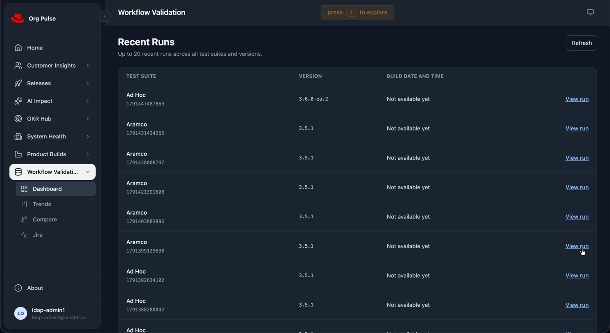
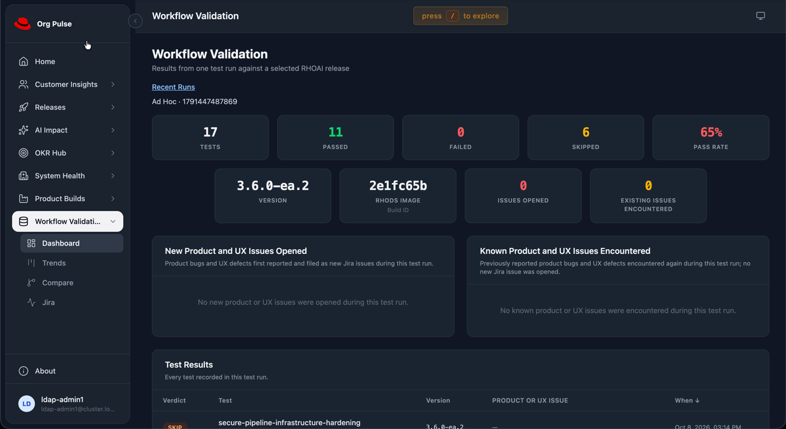

# RHAI-10567 GPUaaS dev preview

Deployed on 2026-10-19 to `workflow-validation-org-pulse` on
`https://api.workval.aipcc-gpuaas.com:6443`.

[Open Dashboard](https://team-tracker-workflow-validation-org-pulse.apps.workval.aipcc-gpuaas.com/#/workflow-validation/recent-runs).

## Scope and build

Dashboard opens the recent-runs list. View run opens the existing Overview
view for the selected suite and invocation. Individual tests stay under
Dashboard. Build date and time remains a placeholder. Actual build dates and
build-time selection/ordering are tracked in
[RHAI-10898](https://redhat.atlassian.net/browse/RHAI-10898).

The preview was built from the uncommitted task worktree based on
`51e62e342bcc90a85b5b92b05c4aa984a614cc1f`. The backend artifact bundle is
`9f36542691f0`. The compatible frontend bundle is `440bd121cd2e`.

Both images extend their previous dev runtime image. The backend keeps core
2.0.82 and receives the changed Workflow Validation runtime files. The frontend
uses the compiled feature with core 2.0.83, matching the previous dev UI shell.
The repository dependency lock remains unchanged. A build with core 2.0.91
introduced a request to an unavailable platform API; the final compatible
build removes that request.

Builds:

- Backend: `org-pulse-backend-rhai10567-1`.
- Frontend: `org-pulse-frontend-rhai10567-2`.

Deployed images:

- Backend: `image-registry.openshift-image-registry.svc:5000/workflow-validation-org-pulse/org-pulse-backend@sha256:2d3e84249c75a4622205bb31b24c631f1e33b8ed54babfbf33974430ec349ff6`.
- Frontend: `image-registry.openshift-image-registry.svc:5000/workflow-validation-org-pulse/org-pulse-frontend@sha256:16392ba2f568df4dcb7c307b0a0fb34271032746ca2eeee0cc132077a6ad2f79`.

Only the application image references changed in the deployment templates.
Existing OpenSearch settings, secret references, OAuth configuration, storage,
and routes remain unchanged. The existing `latest` image tags were not moved.

## Verification

Both deployments completed their rollouts with one ready replica each.
The live API returned the correct 20 rows from 142 run groups. The selected
run was `ad-hoc` / `1791447487869`, version `3.6.0-ea.2`. Its Overview and
Charts responses matched its 17 recorded tests. Individual test
`5386847c-910b-48ee-9101-e7dfa2ce711a` loaded successfully.

Browser checks against the deployed frontend used an authenticated OpenShift
port-forward. They verified the list, selected run, individual test, and return
to Dashboard. No sample gateway was involved. No page errors occurred.
Background People & Teams API 404 responses also occurred with the previous
frontend. The final build introduces no additional failing API paths.

The public route presents its existing OpenShift sign-in page. Its certificate
was verified with the cluster ingress CA. OAuth settings were not changed.

Local checks passed: 97 Workflow Validation unit tests, 18 browser integration
tests, lint, production builds, and OpenAPI validation. Deployment records and
screenshots are in the parent workspace under
`dev/workflow-validation/.state/gpuaas-rhai10567/`. Credentials are not stored
in those records. The user kubeconfig was not changed.

Still images from the user's 2026-10-19 dev recording show the landing page
and a selected run. The build-date placeholder is intentional for this story.





## Rollback

Use a valid login for the named GPUaaS context before running these commands.
Restore the frontend first. Then restore the backend if needed.

```sh
oc --context=default/api-workval-aipcc-gpuaas-com:6443/ldap-admin1 -n workflow-validation-org-pulse set image deployment/frontend nginx=image-registry.openshift-image-registry.svc:5000/workflow-validation-org-pulse/org-pulse-frontend@sha256:4ecefdf3f19cbe18d1260860839dbd745dabecff2eadcecd68e75806d19fb3e2
oc --context=default/api-workval-aipcc-gpuaas-com:6443/ldap-admin1 -n workflow-validation-org-pulse rollout status deployment/frontend
oc --context=default/api-workval-aipcc-gpuaas-com:6443/ldap-admin1 -n workflow-validation-org-pulse set image deployment/backend backend=image-registry.openshift-image-registry.svc:5000/workflow-validation-org-pulse/org-pulse-backend@sha256:bcdf9a5c70b2c2f95edd5b6a0d5f0b49a0e42272a13d7091bec23305b0a576d4
oc --context=default/api-workval-aipcc-gpuaas-com:6443/ldap-admin1 -n workflow-validation-org-pulse rollout status deployment/backend
```
