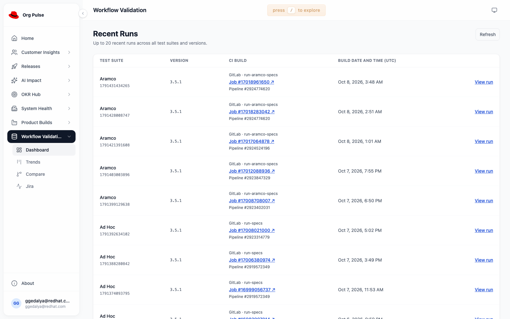
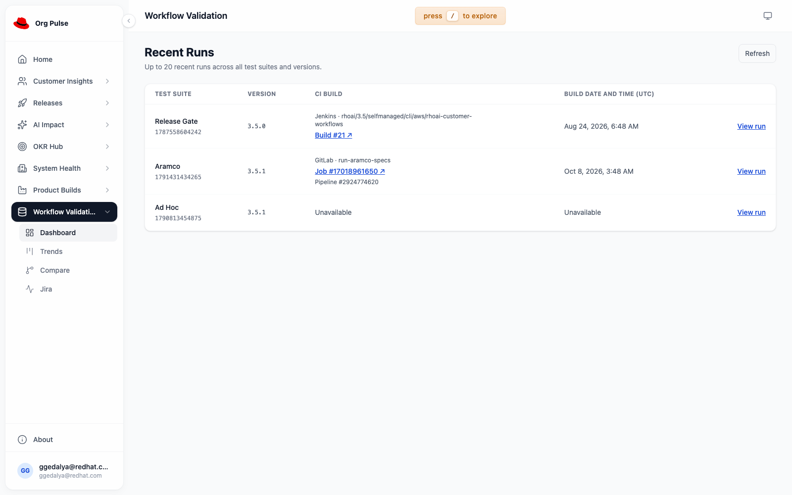

# Recorded CI build links

RHAI-10570 adds the CI job identity and exact build link to each Recent Runs row.
It uses the validated `workflow-suite-builds` association shared with RHAI-10898.
The key is the original suite and invocation, never the individual test UUID.

Jenkins shows its full job name and build number. GitLab shows the job name,
job ID, and recorded pipeline ID. Unknown or invalid associations remain
Unavailable. CI links open a new tab. View run keeps the existing exact-run
dashboard and individual-test navigation.

## Dependencies

Merge landing-page PR #1787, then build-date PR #1792, then this change. This
branch contains those unmerged prerequisites. Its final feature commit isolates
the build-link API, UI, tests, fixtures, documentation, and screenshots. Rebase
after the prerequisites merge. The existing build metadata flag enables the
validated read-only join; no new database fields or migrations are needed here.

## Validation on 2026-10-21

- All 107 Workflow Validation unit tests and all 21 browser checks pass.
- Lint, production build, and OpenAPI validation pass.
- The full local unit command encountered existing core discovery failures,
  unrelated module timeouts, and the known Releases schedule date assertion.
  It was stopped after those failures. Focused feature checks pass.
- The GPUaaS development backend returns 108 verified associations and 34
  unavailable associations across 142 suite runs. Every returned identity, URL,
  and date matches the reviewed metadata inventory.
- The default latest-20 UI renders the 20 expected CI links. Global build-time
  ordering, exact-run navigation, and individual-test navigation pass. No browser
  page errors occurred.
- A synthetic cross-repository check passes through Director capture, immutable
  artifacts, RCA recovery/publishing, Python extraction, and this reader. It also
  verifies retries, conflicting context, unavailable delivery, and local/missing
  context without network requests or remote writes.

The development preview uses the prior compatible UI shell (core 2.0.83) and
extends the prior immutable images. The repository dependency lock is unchanged.
The prior image digests are saved for rollback. This is a development preview;
normal release and live future-run canaries still require reviewed components.
No original execution, task, or root-cause document is changed by this UI work.

## Screenshot proof

Actual GPUaaS development frontend and backend, default latest-20 response:

Representative recorded Jenkins, GitLab, and unresolved rows selected from the
same real backend response in a browser test. This selection includes an older
Jenkins run outside the default latest 20. The browser test changes only its
response selection; it does not modify stored data or the default page:

