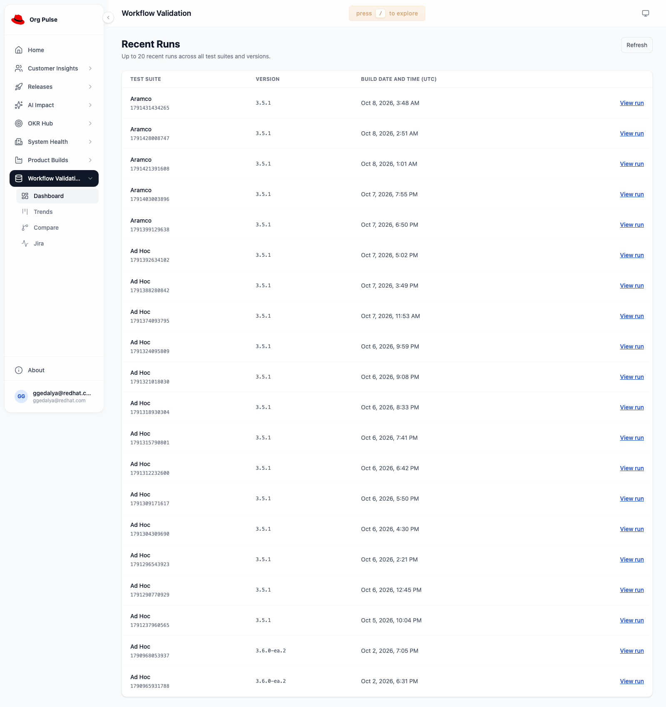

# RHAI-10898 GPUaaS dev validation

Deployed on 2026-10-21 to `workflow-validation-org-pulse`.
[Open Dashboard](https://team-tracker-workflow-validation-org-pulse.apps.workval.aipcc-gpuaas.com/#/workflow-validation/recent-runs).

The live API returns 142 suite runs: 108 have verified original CI starts
(107 GitLab, one Jenkins). The remaining 34 have no build date. All qualifying
run groups are joined before global build-time sorting and the top-20 limit.
No build number or CI job link is added to the UI; RHAI-10570 owns that work.

Before creating metadata, a full export backed up all 5,044 original documents,
IDs, sources, mappings, settings, and aliases. Both private local and encrypted
S3 copies passed checksum verification. A restore into a separate OpenSearch
2.17.0 cluster verified every ID/source and each mapping. The isolated metadata
rehearsal verified two canaries, 106 remaining creates, duplicate-free rerun,
conditional rollback of all 108 records, and reload.

The working load created two canaries and then 106 records in the separate strict
`workflow-suite-builds` index. Read-back matches all reviewed records. All
708 executions, 4,153 tasks, and 183 root causes retain their original sources,
sequence numbers, and primary terms. No result documents were changed.
The backup is an application-data export, not a native cluster snapshot.
It excludes credentials and system state. S3 versioning is disabled; keep the
local copy and define a separate backup retention policy.

Both dev deployments rolled out successfully. The live API verified every date,
all 34 missing dates, deterministic ordering, and the global top 20. Browser
checks verified 20 rendered UTC dates, exact-run navigation, individual-test
navigation, and no page errors. The frontend keeps the deployed core 2.0.83
shell. Only Workflow Validation backend files and compiled frontend assets
changed. The repository dependency lock remains unchanged.

## Rollback

Disable `WORKFLOW_VALIDATION_BUILD_TIME_ENABLED` on the backend to restore the
previous date placeholder and test-time ordering. The previous backend image is
`image-registry.openshift-image-registry.svc:5000/workflow-validation-org-pulse/org-pulse-backend@sha256:2d3e84249c75a4622205bb31b24c631f1e33b8ed54babfbf33974430ec349ff6`.
The previous frontend image is
`image-registry.openshift-image-registry.svc:5000/workflow-validation-org-pulse/org-pulse-frontend@sha256:16392ba2f568df4dcb7c307b0a0fb34271032746ca2eeee0cc132077a6ad2f79`.

Historical metadata can be conditionally removed using the reviewed input,
manifest, and private migration journal with `load_suite_builds.py --rollback`.
The loader checks exact document content and returned versions. It refuses
later changes and never deletes result documents. Private backup, input,
manifest, journal, restore reports, and full validation reports remain outside
git under `dev/rhai-10898-run-matching` in the parent workspace.

## Future runs

Director, RCA, GitLab container forwarding, and Jenkins wrapper changes are
prepared in separate branches. They are not active in live CI until reviewed,
released, and selected by the jobs. Provisioning the index and backfilling
historical records alone does not enable future capture.

## Validation limits

The Workflow Validation unit tests and all 19 module browser checks pass.
The broader dashboard suite exposes pre-existing core symlink-discovery errors
and a Releases schedule-widget date assertion. That date assertion also fails
on the unchanged landing-page branch. Node 26 requires disabling its built-in
web storage for the jsdom storage tests. These issues are outside this change.

The Jenkins wrapper compiles with a temporary JDK 17. Its unit test is pending
because the local JDK cannot validate the certificate chain for the internal
Nexus `kubevirt-cloud` dependency. Run that check in trusted corporate CI before
merging the wrapper change. No live Jenkins job was changed or triggered.
